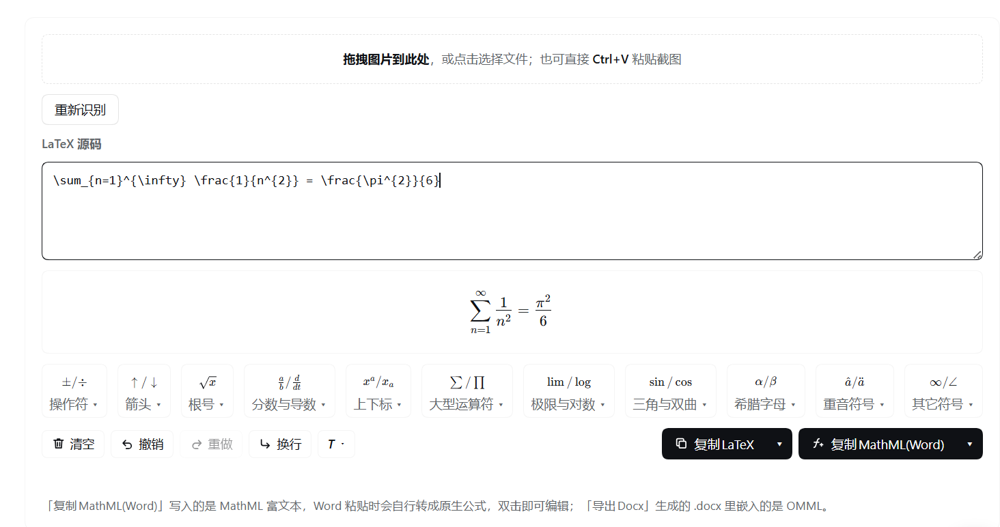

# 公式编辑器 · Formula Editor for DeepSeek Harness

[](LICENSE)
[](https://github.com/deepseek-ai)
[](#从源码构建--build)

> 在 [DeepSeek Harness](https://github.com/deepseek-ai) 里装一个「公式编辑器」：**图片 → LaTeX → Word 原生可编辑公式**。

一个 DSH 原生插件（Cordis bundle），不是独立网页，也没有 iframe。装上之后，左侧导航栏和右侧边栏各多一个入口，打开就是同一个编辑器。



**目录**：[它解决什么问题](#它解决什么问题) · [功能](#功能--features) · [前置要求](#前置要求--requirements) · [安装](#安装--install) · [配置模型](#配置模型--configuration) · [使用](#使用--usage) · [工作原理](#工作原理--how-it-works) · [从源码构建](#从源码构建--build) · [测试](#测试--tests) · [目录结构](#目录结构--project-layout) · [已知限制](#已知限制--known-limitations) · [第三方声明](#第三方声明--third-party-notices) · [License](#license)

---

## 它解决什么问题

写论文、写报告、写作业的时候，公式通常是这三步：找一个公式（截图 / 拍照 / 书上）→ 想办法变成能用的格式 → 粘到 Word 里发现是一张图，或者一堆 `\frac`。

这个插件把这三步压成一步：

1. **图片识别成 LaTeX** —— 拖进来、粘进来或选一张公式截图，视觉模型把它读成 LaTeX；
2. **在公式上直接改** —— 下面的公式域是 MathLive 做的真输入控件，可以直接点进去打字，LaTeX 源码实时同步；
3. **一键变成 Word 原生公式** —— 「复制MathML(Word)」粘进 Word 就是可双击编辑的公式对象，不是图片；也可以直接导出 `.docx`。

---

## 功能 · Features

| | |
| --- | --- |
| **图片 → LaTeX** | 拖拽、`Ctrl+V` 粘贴、点击选择文件；识别结果直接进公式域 |
| **可编辑公式域** | MathLive 输入控件，点进公式里就能改，源码双向同步；随时可「重新识别」恢复成图片里的原公式 |
| **Word 式符号面板** | 11 个类别、272 个符号与模板（操作符 / 箭头 / 根号 / 分数与导数 / 上下标 / 大型运算符 / 极限与对数 / 三角与双曲 / 希腊字母 / 重音符号 / 其它），点一下插到光标处，模板类会停在空位里 |
| **10 种数学样式** | `\mathrm` `\mathbf` `\mathit` `\mathbb` `\mathcal` `\mathfrak` `\mathsf` `\mathtt` `\text` `\overline`，选中即包裹 |
| **复制为 Word 原生公式** | 粘进 Word 是可编辑的公式对象（`OMaths.Count = 1`、`InlineShapes.Count = 0`） |
| **导出 .docx** | 生成的 docx 里嵌的是 OMML，Word / WPS 都能直接编辑 |
| **多种复制格式** | LaTeX（6 种包裹：裸的、`$...$`、`$$...$$`、`\[...\]`、`\(...\)`、`equation` 环境）、MathML(Word)、AsciiMath、Typst |
| **两个入口一份界面** | 左侧全局导航（整页）+ 右侧边栏 Tab（边聊边算），同一套组件；两个入口各自独立，互不干扰 |
| **自带图标** | 插件列表里显示自己的 ∑ 徽标 |

界面全部是本地资产：**无 CDN、无外部网页请求、无 iframe**。

---

## 前置要求 · Requirements

- **DeepSeek Harness** `>= 0.2.0-rc.1`（`package.json` 的 `engines.dsh`）
- **一个能看图的模型**，用来把图片读成 LaTeX。插件调用的是**你自己**的 OpenAI 兼容接口（`/chat/completions`），不绑定任何厂商——把你已经在用的那个视觉模型指过来就行，**不用为了这个插件单独申请 Key**。见 [配置模型](#配置模型--configuration)
- 右侧边栏 Tab 需要 `dsh-better-sidebar`；**没有它插件照样能用**，只是少了右侧 Tab 和设置面板，左侧整页入口不受影响

---

## 安装 · Install

### 方式一：直接从 GitHub 装（推荐）

在 DSH 会话里让 Agent 执行：

```
plugin_manager install_bundle({ target: 'github:YaoZhang0224/dsh-formula-editor' })
```

或者用完整地址：

```
plugin_manager install_bundle({ target: 'https://github.com/YaoZhang0224/dsh-formula-editor' })
```

### 方式二：本地目录

把仓库 clone 或解压到任意位置（路径必须是**绝对路径**），然后：

```
plugin_manager install_bundle({ target: 'D:\\tools\\dsh-formula-editor' })
```

这种装法建的是目录链接（junction），好处是以后改源码立刻生效，坏处是**那个目录不能删也不能移动**。

### 方式三：`.tgz` 压缩包

```bash
git clone https://github.com/YaoZhang0224/dsh-formula-editor
cd dsh-formula-editor
npm run pack     # → dist/dsh-formula-editor-1.0.0.tgz
```

把 `.tgz` 发给别人，对方：

```
plugin_manager install_bundle({ target: 'C:\\Users\\me\\Downloads\\dsh-formula-editor-1.0.0.tgz' })
```

也支持 HTTP 地址。

### 装完之后

**刷新页面**（`Ctrl+R`）或重启 DSH 桌面应用。插件的 client 半边是页面加载时注入的，刷新就会重新拉，不用重装。

左侧导航栏「技能中心」之后会出现 **∑ 公式编辑器**；如果装了 `better-sidebar`，右侧工具列表里也会多一个「公式编辑器」Tab。

卸载：

```
plugin_manager remove_bundle({ target: 'dsh-formula-editor' })
```

> **注意**：不要把插件目录放进 `node_modules`，pnpm 下一次 install 会把它清掉。也不要改 `package.json` 的 `name`——`cordis.patch.yml` 的 `insert id` 和 profile 的 `dsh.profile.bundles` 都按包名寻址。

---

## 配置模型 · Configuration

图片识别就是一次普通的 OpenAI 兼容 `/chat/completions` 调用，图片以 `image_url`（data URL）传过去。**用你自己已经在用的那个视觉模型就行**——你手上哪家有能看图的模型、有 Key，就用哪家，插件不绑定任何厂商，也不需要为了它单独申请账号。

要配的只有两件事：**接口地址 + 模型名**，以及**那把 Key**。

### 接口与模型

插件有三个 `Config` 字段，在 profile 的 `cordis.patch.yml` 里覆盖：

```yaml
- id: dsh-formula-editor
  config:
    baseURL: 'https://your-endpoint.example/v1'   # 任何 OpenAI 兼容的 /v1
    model: 'your-vision-model'                    # 必须支持图片输入
    apiKeyRef: 'FORMULA_OCR_API_KEY'              # 下面说的凭据名
```

改完 `Ctrl+R` 刷新页面即可生效（Loader 会热重载这一条）。

> **一定要改成你自己的。** 插件里带的 `baseURL` / `model` 默认值只是作者开发时用的那家接口，**不是**这个插件的要求，也不代表你要用同一家。任何 OpenAI 兼容、支持图片输入的服务都能跑，换掉这两个值就行，其它都不用动。
>
> `baseURL` 只写到接口的 `/v1` 为止，插件自己拼 `/chat/completions`。
> 挑模型时确认它**支持图片输入**——纯文本模型会把图片丢掉，或者直接报错。

### Key

Key 走 DSH 的凭据系统，两种给法：

1. **在插件设置里填（推荐）** —— 「设置 → 侧边卡片 → 公式编辑器 → 功能设置」，粘贴后保存。值存在 DSH 的凭据存储里，**不会写进插件文件、不会进 git**。
2. **写进 profile 的凭据文件** —— 在 `~/.dsh/.credentials.yaml` 的 `refs:` 下加一行，名字和上面的 `apiKeyRef` 对应：

```yaml
refs:
  FORMULA_OCR_API_KEY: sk-your-key-here
```

设置面板会显示当前用的是哪把 Key、来自哪里（只显示来源，不显示值）。没配 Key 时点识别会提示「尚未配置 OCR API Key」。

> 如果你本来就在 DSH 里配过某个视觉模型的 Key，可以把 `apiKeyRef` 直接指向那个已有的凭据名，不用再存一份。

### 换个模型会怎样

没有额外步骤。改完 `baseURL` / `model` 刷新页面，识别就走新接口。插件只要求对面认 OpenAI 的 `messages` + `image_url` 格式；返回内容从 `choices[0].message.content` 里取，包了 ```` ``` ````、`$$`、`\[` 这类外壳会自动剥掉。

---

## 使用 · Usage

### 左侧整页入口

1. 点左上角图标竖栏里的 **∑ 公式编辑器**（排在「技能中心」之后）
2. 中央主区域打开整页编辑器，左侧该行高亮
3. 点「新会话」等其它入口，高亮自动取消

### 右侧边栏 Tab

1. 打开右侧边栏，工具列表里点「公式编辑器」
2. 界面与整页版完全一致

### 面板里有什么

- **拖拽区** —— 拖入图片 / 点击选择文件 / `Ctrl+V` 粘贴截图
- **重新识别** —— 用原图重跑 OCR，覆盖当前公式
- **LaTeX 源码框** —— 手写或粘贴源码
- **公式编辑区** —— 直接在公式上点、选、打字；源码框实时跟着变，反过来改源码公式也立刻重绘
- **符号面板** —— 11 个类别框，点 `▾` 展开同类符号与函数
- **工具栏** —— 清空 / 撤销 / 重做 / 换行 / `T` 数学样式
- **复制LaTeX ▾** 与 **复制MathML(Word) ▾** 两个主按钮

### 复制到 Word 的正确姿势

点 **复制MathML(Word)** 的主按钮，然后在 Word 里 `Ctrl+V`。得到的是**原生公式对象**，双击可以继续编辑，不是图片、不是 LaTeX 源码。

如果要一整份带公式的文档，用 **导出Docx(Word/WPS)**，生成的 `.docx` 里嵌的是 OMML。

> Word 版本要求：Microsoft 365 已验证。2007 以前的 Word 不支持 MathML 转换。

---

## 工作原理 · How it works

### 整体结构

```
┌──────────────────────── Client (browser) ────────────────────────┐
│  React 组件（src/client-ui.js）                                   │
│    ├─ 符号面板 / 工具栏 / 两个下拉按钮                            │
│    ├─ MathLive <math-field>  ←→  LaTeX 源码（双向同步）           │
│    └─ 剪贴板 / docx 生成（src/convert.js，纯函数）                │
└──────────────────────────────────────────────────────────────────┘
                              │ 同源 fetch
┌──────────────────────── Host (Node) ─────────────────────────────┐
│  index.js：三条同源路由                                           │
│    POST /plugins/dsh-formula-editor/ocr       代理视觉模型         │
│    GET|POST /plugins/dsh-formula-editor/settings  读写 Key         │
│    GET  /plugins/dsh-formula-editor/assets/*  KaTeX / MathLive 资产│
└──────────────────────────────────────────────────────────────────┘
```

### 转换管线

```
图片 ──(视觉模型)──> LaTeX
LaTeX ──(temml)──> MathML ──(text/html 剪贴板)──> Word 内部转 OMML
LaTeX ──(temml + mathml2omml)──> OMML ──(自写 OOXML + ZIP)──> .docx
LaTeX ──(自写递归下降)──> AsciiMath
LaTeX ──(tex2typst)──> Typst
```

### 三个不太显然的实现决定

**1. 「复制为 Word 公式」写的是 MathML，不是 OMML。**

直觉上应该把 `<m:oMath>` 放进 `text/html`，但实测 Word 的 HTML 导入器会**静默丢弃**全部 OMML——试过 6 种命名空间与 shell 组合（openxmlformats 2006-06、microsoft 2004-12 omml、`m:oMathPara`、`<!--[if gte msEquation 12]>` 条件注释、Word 完整命名空间 shell、极简 shell），结果都只剩纯文本。

换成 `<math xmlns="http://www.w3.org/1998/Math/MathML">` 反而成功：Word 粘贴后自己转成原生 OMath 对象。`xmlns` 必须存在，缺了它 Word 完全静默忽略公式——这是唯一一个不报错的坑。

**2. 重音符号要手工补 `accent`。**

temml 输出的 `<mover>` 不带 `accent` 属性，mathml2omml 会 fallback 成 `<m:limUpp>`，Word 里 `\hat{H}` 就显示成上下标而不是帽子。`src/convert.js` 的 `fixAccents()` 给 `<mover>` / `<munder>` 里的单字符重音补 `accent="true"` / `accentunder="true"`，让它走 `m:acc` 分支。

**3. `.docx` 是手写的 OOXML。**

`docx` 这类库不接受原始 OMML XML，没法把任意公式的 OMML 塞进段落。手写 7 个部件（`[Content_Types].xml`、`_rels/.rels`、`word/_rels/document.xml.rels`、`word/document.xml`、`word/styles.xml`、`docProps/core.xml`、`docProps/app.xml`）加一个 STORE-only ZIP + CRC32 就够了，单公式文档约 5–6 KB，零依赖。

### 可编辑公式域的几个坑

MathLive 的 `<math-field>` 是 contenteditable + shadow DOM，和 React 一起用有几处反直觉的地方（细节见源码注释）：

- **`input` 事件必须手写 `addEventListener`**：React 18 对自定义元素会把 `onInput` 当成普通属性挂上去，事件永远不触发。
- **`className` 也得手写** `node.className = '...'`：React 会写成 `classname="..."`，class 根本不存在。
- **焦点归属用 document 级 `focusin` 追踪**：点符号面板按钮会让 `<math-field>` 失焦，`focus`/`input` 都来不及。
- **模板光标用 `#@`**：`insert('\\frac{#@}{}')` 会把光标送进分子，读回源码时要剥掉 `\\placeholder{}`。
- **居中只能写 `::part(content)`**：`container` 是 `inline-flex` + `justify-content: space-between`，改它没用。

### 为什么用同源路由

`webServer.register` 的三条路由都挂在插件自己的 `/plugins/dsh-formula-editor/` 前缀下，页面用同源 `fetch()` 调用，自动带认证，规避 CORS 与 401。字体必须自己提供：`frontend-static` 的 MIME 表没有 `.woff2`，`client-modules` 的 assets 路由只认图片扩展名。

前缀**不能带尾斜杠**：`webServer.match` 只接受 `pathname === prefix || pathname.startsWith(prefix + '/')`。

---

## 从源码构建 · Build

```bash
git clone https://github.com/YaoZhang0224/dsh-formula-editor
cd dsh-formula-editor
npm run build        # src/*.js → client.js
npm run icon         # scripts/icon-source.png → icon.png
npm run pack         # → dist/dsh-formula-editor-1.0.0.tgz
```

仓库**没有 npm 依赖**（`dependencies` 与 `devDependencies` 都是空的），所以**不需要 `npm install`**。`client.js` 已内联全部转换模块，`assets/` 与 `vendor/` 都在仓库里，构建和运行都不联网。

`client.js` 是构建产物，但它**也提交进仓库**：这样 `install_bundle` 装完就能直接用，别人不必先装 Node 再构建。

重新生成 MathLive 资产（只有升级 MathLive 时才需要）：

```bash
npm pack mathlive@0.111.4 && tar -xzf mathlive-0.111.4.tgz
node scripts/fetch-mathlive.mjs ./package
```

这个脚本会顺手做两件事：把字体 URL 从 `url(fonts/...)` 改写成 `url(../katex/fonts/...)`（复用已有的 20 个 woff2，不重复打包），并删掉 `mathlive-static.css` 里重复的 20 条 `@font-face`（否则会 404）。

---

## 测试 · Tests

```bash
npm test             # Node 侧：转换管线 + 符号数据 + Host 路由 + 搬家测试
npm run test:browser # 浏览器侧：143 项端到端断言（需要本机有 Chrome 或 Edge）
npm run test:all     # 全部
```

| 脚本 | 覆盖内容 |
| --- | --- |
| `scripts/test-convert.mjs` | 12 个公式（重音 / 矩阵 / 积分 / 根式 / cases）走完整转换管线 |
| `scripts/test-symbols.mjs` | 272 个符号逐项过 temml，10 种样式，`splitInsert` 契约 |
| `scripts/test-host.mjs` | 三条 Host 路由的状态码与错误分支；有 Key 时跑一次真实 OCR |
| `scripts/test-relocate.mjs` | 把插件复制到**带空格**的新路径，断言仍能 import、资产齐全、无绝对路径残留 |
| `test/browser/run.mjs` | 无头 Chrome 跑真实 React 组件：注册元数据、两个菜单的标签与剪贴板输出、Word 剪贴板 payload、MathLive 双向同步、11 个符号图库逐项渲染、撤销重做、导航图标网格 |

浏览器测试需要 Chrome 或 Edge。脚本会自动在常见安装位置查找，也可以用环境变量指定：

```bash
CHROME=/path/to/chrome npm run test:browser
```

安装状态自查（profile 是否仍指向本目录、文件是否一致）：

```bash
npm run verify       # → INSTALL OK
```

---

## 目录结构 · Project layout

```
dsh-formula-editor/
├── index.js                 Host 半边：OCR / 设置 / 资产三条同源路由
├── client.js                构建产物：Client 半边（__ModuleLoader__ 注册 + 内联转换模块）
├── package.json             dsh.bundle.patch + dsh.client(platform: web)
├── cordis.patch.yml         bundle patch（insert 一条 id: dsh-formula-editor）
├── icon.png                 插件图标（512×512 透明底，80 KB）
├── screenshot.png           README 截图
├── LICENSE                  MIT
├── .gitattributes           统一 LF，二进制文件不参与换行转换
├── locale/{zh,en}.json      名称与描述
├── src/
│   ├── convert.js           纯函数转换：MathML / OMML / AsciiMath / docx / ZIP / CRC32
│   ├── symbols.js           符号数据：11 类 272 项 + 10 种样式
│   └── client-ui.js         React UI：编辑器 / 符号面板 / 两个入口
├── assets/
│   ├── katex/               KaTeX 引擎、样式、20 个 woff2 字体
│   ├── mathlive/            MathLive 引擎与样式（字体复用 KaTeX 那套）
│   └── vendor/              temml / mathml2omml / tex2typst
├── vendor/                  上游 LICENSE 留档（运行时不从这里取代码）
├── scripts/                 构建、打包、图标生成、Node 侧测试
└── test/
    ├── fixtures/formula.png 真实 OCR 样例（供 test-host.mjs 跑联网检查）
    └── browser/             浏览器端测试：静态服务器 + 自测页 + 驱动脚本 + React
```

仓库共 67 个文件、约 2.4 MB，其中 1.6 MB 是内联的引擎与字体——这是刻意的：插件运行时**不联网、不装依赖**。

---

## 已知限制 · Known limitations

- **AsciiMath 用函数式 `frac(a)(b)` 记法**，不是 `a/b`。这是 AsciiMath 的标准写法之一，MathJax 的 AsciiMath 解析器两种都接受。
- **OCR 依赖外部视觉模型 API**，需要网络与有效 Key。
- **公式域内输入会触发 MathLive 的 inlineShortcuts**：打 `alpha` 会自动变 α、`sqrt` 变根号。这是 MathLive 的默认行为，想关掉可以设 `MathfieldElement.inlineShortcuts = {}`。
- **Word 2007 以前的版本**不支持 MathML → OMath 转换。
- **左侧入口的位次是 `order: 40`**，排在「技能中心」之后。要让位次变化，改 `src/client-ui.js` 里注册 `sidebar.panellist` 时的 `order` 再 `npm run build`。装上别的插件后位次可能撞车，此时改 `order` 即可——DSH 内置的几个入口通常占用 0、1、4、10、30 附近。
- **插件列表图标有 256 KiB 上限**：超了 DSH 会把整个元数据读取判为失败，图标消失并在该行下面显示红色诊断。`npm run icon` 会断言这个预算。

---

## 第三方声明 · Third-party notices

运行时不依赖任何 npm 包，第三方库全部以文件形式随仓库分发：

| 库 | 版本 | 许可 | 用途 |
| --- | --- | --- | --- |
| [MathLive](https://github.com/arnog/mathlive) | 0.111.4 | MIT | 可编辑公式域 |
| [KaTeX](https://github.com/KaTeX/KaTeX) | 0.16.47 | MIT | 符号面板样张渲染、字体 |
| [Temml](https://github.com/ronkok/Temml) | 0.14.0 | MIT | LaTeX → MathML |
| [mathml2omml](https://github.com/transpect/mathml2omml) | 0.5.0 | LGPL-3.0-or-later | MathML → OMML |
| [tex2typst](https://github.com/xiyuyizhi/tex2typst) | 0.6.2 | Apache-2.0 | LaTeX → Typst |
| [React](https://react.dev) / ReactDOM | 18.3.1 | MIT | 仅测试页使用，不打进插件 |

完整许可文本在 `vendor/`（以及 `test/browser/vendor/LICENSE-react`）。

---

## License

[MIT](LICENSE) © 2026 YaoZhang0224
